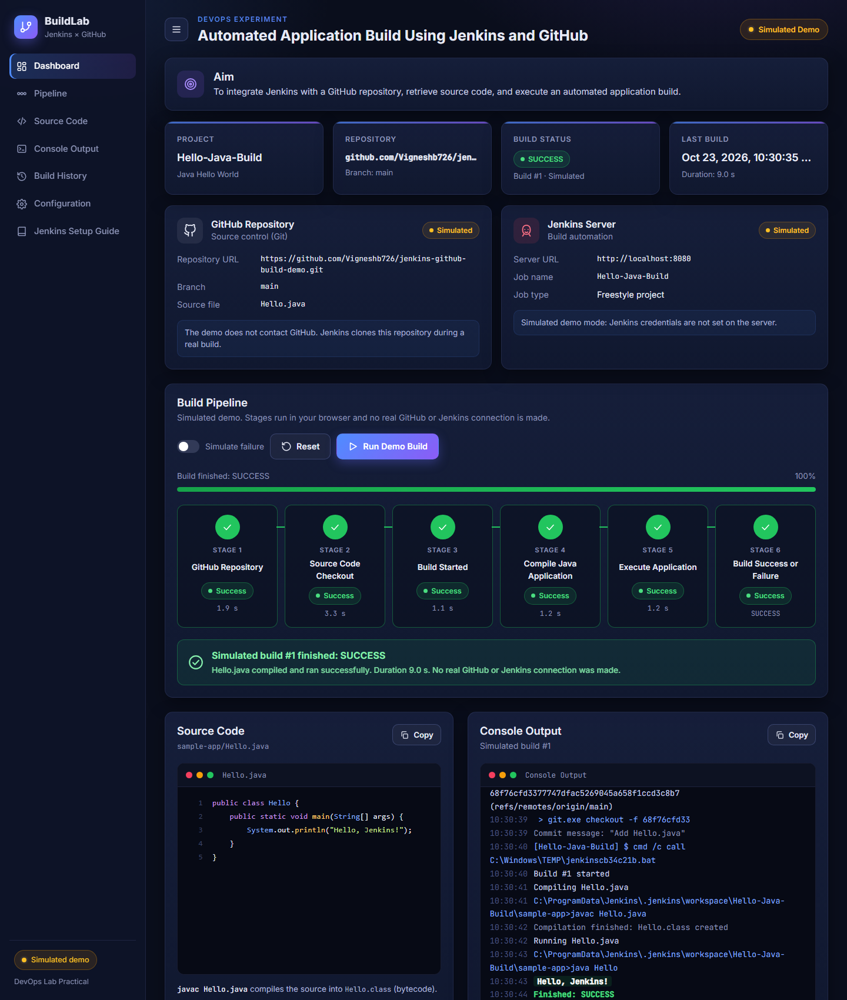

# Automated Application Build Using Jenkins and GitHub

**Aim:** To integrate Jenkins with a GitHub repository, retrieve source code, and execute an automated application build.

This project contains:

1. A **sample Java application** (`sample-app/Hello.java`) that Jenkins builds.
2. A **Jenkins Freestyle job** configuration and build commands (`jenkins/`).
3. A **DevOps dashboard** (HTML/CSS/JS + small Flask backend) that demonstrates the pipeline.
   With no Jenkins credentials configured it runs a clearly labelled **simulated demo**. With credentials it can trigger and stream a **real** Jenkins build.



---

## Project structure

```
jenkins-github-build-demo/
├── app.py                         Flask backend (serves the site, optional Jenkins proxy)
├── requirements.txt               Python dependency (Flask)
├── .env.example                   Template for real Jenkins settings (copy to .env)
├── sample-app/
│   └── Hello.java                 The Java program Jenkins compiles and runs
├── jenkins/
│   ├── freestyle-job-config.xml   Sample Freestyle job (Git SCM + batch build step)
│   ├── build-commands.bat         Build step for Jenkins on Windows
│   └── build-commands.sh          Build step for Jenkins on Linux/macOS
├── static/
│   ├── index.html                 Dashboard page
│   ├── css/style.css              Dark blue/purple theme, responsive layout
│   └── js/app.js                  Pipeline simulation, history, config, real-mode client
└── docs/screenshots/              Dashboard screenshots
```

## Technology stack

| Part | Tool |
|---|---|
| Frontend | HTML, CSS, JavaScript (no frameworks) |
| Backend | Python Flask (optional; only needed for real Jenkins mode) |
| Source control | Git + GitHub |
| Build automation | Jenkins (Freestyle project) |
| Sample app | Java `Hello.java` |

---

## Run the website locally on Windows

Prerequisite: Python 3.10 or newer ([python.org](https://www.python.org/downloads/), tick **Add Python to PATH**).

```powershell
cd jenkins-github-build-demo
python -m venv .venv
.venv\Scripts\activate
pip install -r requirements.txt
python app.py
```

Open **http://127.0.0.1:5000** and click **Run Demo Build**. Press `Ctrl+C` in the terminal to stop the server.

> No Python? Double-click `static/index.html`. The simulated demo still works without the backend.

### Dashboard features

- Project, repository, build status, and last build time cards
- GitHub and Jenkins status cards
- Six-stage visual pipeline: GitHub Repository → Source Code Checkout → Build Started → Compile Java Application → Execute Application → Build Success or Failure
- **Run Demo Build**, **Reset**, and a **Simulate failure** switch (shows a compile error and `Finished: FAILURE`)
- Live console output, `Hello.java` viewer, build history (stored in the browser)
- Configuration form for the GitHub repository URL and the Jenkins server URL
- `?autorun=1` in the URL starts a demo build on page load (handy for screenshots)

---

## Run the real experiment in Jenkins

### 1. Prerequisites on the Jenkins machine

- JDK 17 or newer (`java -version`, `javac -version`)
- Git (`git --version`)
- Jenkins: either the Windows installer from [jenkins.io](https://www.jenkins.io/download/), or the WAR file:

```powershell
java -jar jenkins.war --httpPort=8080
```

Open http://localhost:8080. Unlock Jenkins with the password from
`%USERPROFILE%\.jenkins\secrets\initialAdminPassword`, choose **Install suggested plugins** (this includes the Git plugin), and create an admin user.

### 2. Push the source code to GitHub

```powershell
git init
git add .
git commit -m "Add Jenkins x GitHub build demo"
git branch -M main
git remote add origin https://github.com/YOUR-USERNAME/jenkins-github-build-demo.git
git push -u origin main
```

### 3. Create the Freestyle job

1. **New Item** → name `Hello-Java-Build` → **Freestyle project** → OK.
2. **Source Code Management** → **Git**
   - Repository URL: `https://github.com/YOUR-USERNAME/jenkins-github-build-demo.git`
   - Branch Specifier: `*/main`
   - Credentials: none needed for a public repository
3. **Build Steps** → **Add build step** → **Execute Windows batch command**:

   ```bat
   cd sample-app
   javac Hello.java
   java Hello
   ```

   On Linux use **Execute shell** with the same commands (see `jenkins/build-commands.sh`).
4. **Save** → **Build Now** → open the build → **Console Output**.

Expected console output (abridged):

```
Started by user admin
Cloning the remote Git repository
Cloning repository https://github.com/YOUR-USERNAME/jenkins-github-build-demo.git
Checking out Revision 1a2b3c... (refs/remotes/origin/main)
...\workspace\Hello-Java-Build\sample-app>javac Hello.java
...\workspace\Hello-Java-Build\sample-app>java Hello
Hello, Jenkins!
Finished: SUCCESS
```

`jenkins/freestyle-job-config.xml` contains the same job as XML. You can import it with the Jenkins CLI instead of clicking through the UI:

```powershell
java -jar jenkins-cli.jar -s http://localhost:8080/ -auth USER:API_TOKEN create-job Hello-Java-Build < jenkins\freestyle-job-config.xml
```

### 4. (Optional) Connect the dashboard to real Jenkins

1. In Jenkins: click your user name → **Security** → **API Token** → **Add new token** → copy it.
2. Copy `.env.example` to `.env` and fill in the values:

   ```
   JENKINS_URL=http://localhost:8080
   JENKINS_JOB=Hello-Java-Build
   JENKINS_USER=admin
   JENKINS_API_TOKEN=<your token>
   ```

3. Restart `python app.py`. The badge changes to **Jenkins Connected** and a **Run Real Jenkins Build** button appears. It triggers the job and streams the real console log into the dashboard.

**Security:** the username and token stay in `.env` on the server, which is listed in `.gitignore`. The browser only talks to the Flask backend (`/api/...`), and the backend adds the credentials. Nothing secret is in the JavaScript.

Backend API used by the dashboard:

| Endpoint | Jenkins REST call |
|---|---|
| `GET /api/status` | `GET /job/<job>/api/json` (connectivity check) |
| `POST /api/jenkins/build` | `POST /job/<job>/build` → queue item |
| `GET /api/jenkins/queue/<id>` | `GET /queue/item/<id>/api/json` → build number |
| `GET /api/jenkins/builds/<n>` | `GET /job/<job>/<n>/api/json` → result, duration |
| `GET /api/jenkins/builds/<n>/log` | `GET /job/<job>/<n>/logText/progressiveText` |

---

## Viva notes

- **Jenkins**: an open-source automation server for CI/CD. It runs jobs (builds, tests, deployments) automatically or on demand.
- **GitHub**: hosts the Git repository. Jenkins clones it with the Git plugin at the start of each build.
- **Freestyle project**: the simplest Jenkins job type, configured through the web UI with SCM, triggers, build steps and post-build actions.
- **Workspace**: the folder where Jenkins checks out code for a job (`.jenkins\workspace\Hello-Java-Build`).
- **Build steps**: `javac Hello.java` compiles the source to `Hello.class` (bytecode). `java Hello` runs it on the JVM.
- **Build result**: SUCCESS when every step exits with code 0, FAILURE when a step fails, for example a compile error.
- **Automatic triggers**: *Poll SCM* (e.g. `H/5 * * * *`) or a *GitHub webhook* (`http://<jenkins>/github-webhook/`) can start the build on every push.
- **Simulated vs real**: the **Run Demo Build** button is a browser animation that contacts neither GitHub nor Jenkins. The **Run Real Jenkins Build** button uses the Jenkins REST API through the backend.
